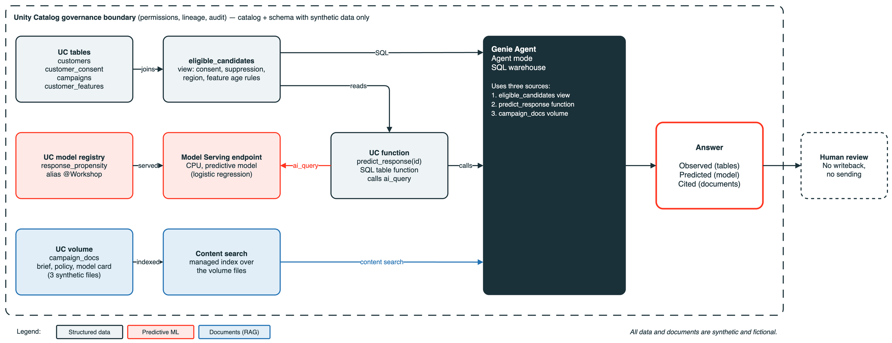

# Genie + ML + RAG agents demo

One Genie Agent that answers a marketing question end to end: it reads customer tables, calls an ML model through a
SQL function, and quotes campaign documents. Deploy it to your workspace with one Declarative Automation Bundle (DAB).
All data and documents are synthetic.



## What you get

| Piece | What it is |
|---|---|
| Synthetic data | 5 Delta tables (3,000 past customers, 20 current customers, consent, features, one campaign) and an `eligible_candidates` view |
| ML model | Scikit-learn logistic regression, logged with MLflow 3 and registered in Unity Catalog (alias `workshop`) |
| Serving | Model Serving endpoint (CPU Small, scale to zero by default) |
| SQL bridge | `predict_response(customer_id)` Unity Catalog SQL function that calls the endpoint with `ai_query` |
| Documents | Three campaign Markdown files in a volume, searched by Genie content search (RAG) |
| Genie Agent | Space "Synthetic Campaign Decision Assistant" with tables, function, joins, examples and instructions |
| Metadata | Table comments, NOT NULL and informational PK/FK keys so Genie One can discover and join the assets |
| Scripts | [Genie Agent](docs/demo_script_genie_agent.md) and [Genie One](docs/demo_script_genie_one.md) 7-turn conversations, [acceptance tests](docs/acceptance_tests.md) |

## Prerequisites

- A Unity Catalog **catalog with managed storage** where you can create a schema, volume, model and function.
- **Serverless** compute for jobs and notebooks, and Model Serving enabled.
- A **Pro or serverless SQL warehouse**. The bundle looks up one named "Serverless Starter Warehouse" by default.
- **Genie Agent mode with file analysis (Beta)** and **content search** available in your region.
- **Databricks CLI** v1.18 or later (the version this bundle was validated with).
- A CLI profile for your workspace: `databricks auth login --host <workspace-url> --profile <profile>`.

## Quickstart

```bash
git clone <this-repo-url> && cd genie-ml-rag-agents-demo
databricks bundle validate -t dev --var catalog=<your_catalog> --profile <profile>
databricks bundle deploy   -t dev --var catalog=<your_catalog> --profile <profile>
databricks bundle run demo_setup -t dev --var catalog=<your_catalog> --profile <profile>
```

The run takes roughly 15 to 30 minutes, mostly waiting for the endpoint. Optional variables:
`--var schema=...`, `--var volume=...`, `--var endpoint_name=...`, `--var genie_title=...`,
`--var warehouse_id=<id>` (if you have no "Serverless Starter Warehouse"), `--var scale_to_zero=false`.

The job is safe to re-run. It **overwrites the tables in the demo schema**, registers a new model version,
moves the `workshop` alias and updates the endpoint and the Genie space in place. Use a dedicated schema.

## Two manual steps

These have no public API, so do them once after the first run.

1. **Enable content search on the volume:** Catalog > your catalog > the demo schema > `campaign_docs` >
   Overview > Content search > **Enable**. Wait for Ready. After every re-run, re-sync it there:
   the index does not pick up changed files on its own.
2. **Switch Genie to Agent mode:** open the space and use the Agent toggle on the new-chat box. Chat mode ignores volumes.

## Run the demo

1. Open the Genie space "Synthetic Campaign Decision Assistant" in **Agent mode** and start a **new chat**.
2. Follow [docs/demo_script_genie_agent.md](docs/demo_script_genie_agent.md). Keep all turns in one chat.
3. Then open Genie One and follow [docs/demo_script_genie_one.md](docs/demo_script_genie_one.md). Use the exact wording:
   Genie One searches the whole workspace.
4. Warm up about 10 minutes before presenting: ask turns 2 and 3 once. With scale to zero the first score can be slow.
   For a live demo deploy with `--var scale_to_zero=false`, which keeps the endpoint always on.

## Rebuild with Genie Code

Prefer to build it interactively, or adapt it to your own data? [PROMPTS.md](PROMPTS.md) has eight copy-paste prompts
for Genie Code that rebuild each piece step by step, without the bundle.

## Troubleshooting

| Symptom | Cause and fix |
|---|---|
| `UNSUPPORTED_OPERATION` on `errorifexists` | Serverless Spark Connect accepts `mode("error")`, not `errorifexists`. The scripts use `overwrite`. |
| Genie says it has no documents | Chat mode or content search not enabled. Use Agent mode and enable content search on the volume. |
| Answers quote old model version or text | The content search index is stale after a re-run. Re-sync it in the Catalog UI (volume > Overview > Content search). |
| Only the classic Conversation API gives no document answers | That API runs Chat mode. Use the UI Agent toggle or `POST /api/2.0/genie/agents/{space_id}/responses`. |
| Genie space has no volume | If the API rejects the volume entry the job creates the space without it. Add it: space > Sources > Add > Volume. |
| First score times out | Scale-to-zero cold start. Wait a few minutes and retry, or deploy with `--var scale_to_zero=false`. |
| Space content looks garbled | Every element of `content` and `sql` arrays in `serialized_space` must end in `\n`. |
| Raw `:citation[...]` text in replies | Cosmetic UI behavior. The instructions make Genie end answers with a `Sources:` line. |
| Warehouse lookup fails | No warehouse named "Serverless Starter Warehouse". Pass `--var warehouse_id=<id>`. |
| Genie One mentions other projects | It searches the whole workspace. Use the anchored wording from the script. |

## Cost and cleanup

- The serving endpoint is the main cost. With `scale_to_zero=false` it bills continuously until deleted.
- Remove everything the bundle created from the workspace: `databricks bundle destroy -t dev --profile <profile>`.
  This deletes the job. It does **not** delete the schema, model, endpoint, function or Genie space, because the
  job (not the bundle) created them. Remove those by hand:

```bash
databricks serving-endpoints delete <endpoint_name> --profile <profile>
databricks genie trash-space <space_id> --profile <profile>
databricks schemas delete <catalog>.<schema> --force --profile <profile>
```

## Repository layout

```text
databricks.yml                      bundle, variables, target
resources/demo_setup.job.yml        serverless job, 5 chained tasks
src/01_build_data_and_model.py      data, view, model, documents, fallback scores
src/02_deploy_endpoint.py           endpoint create or update, REST parity check
src/03_create_function_and_metadata.py   predict_response, comments, keys
src/04_create_genie_agent.py        Genie space create or update
src/05_smoke_test.py                known-answer SQL checks
docs/                               demo scripts, acceptance tests, architecture
```

## Disclaimer

Every customer, campaign, rule, outcome and document in this repo is synthetic and fictional. The model is trained on
generated data and is a demo, not a validated or production system. It must not be used to make real customer decisions.
Licensed under the MIT License.
